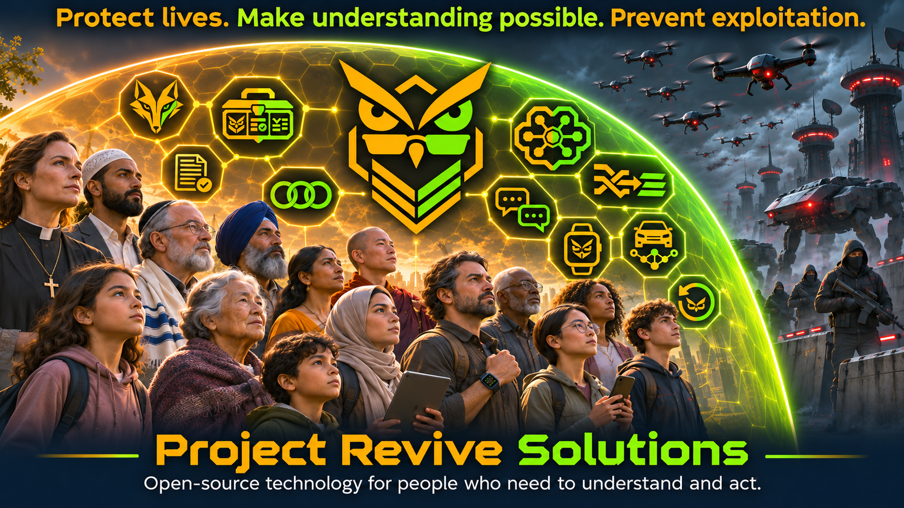
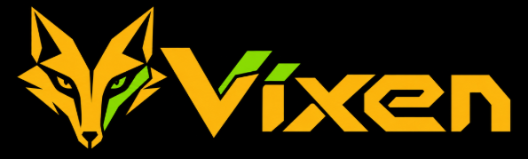
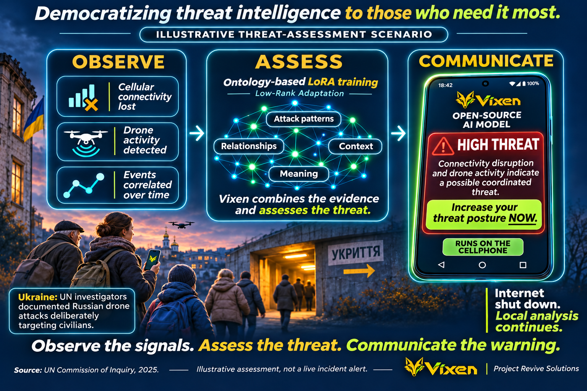
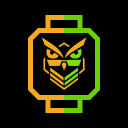
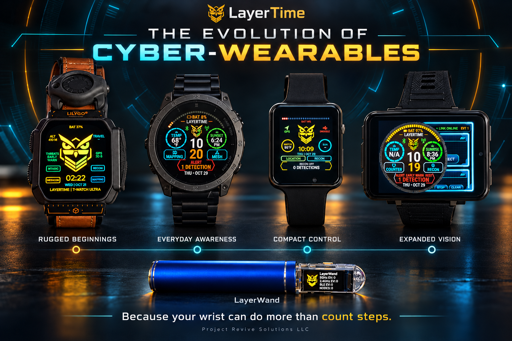
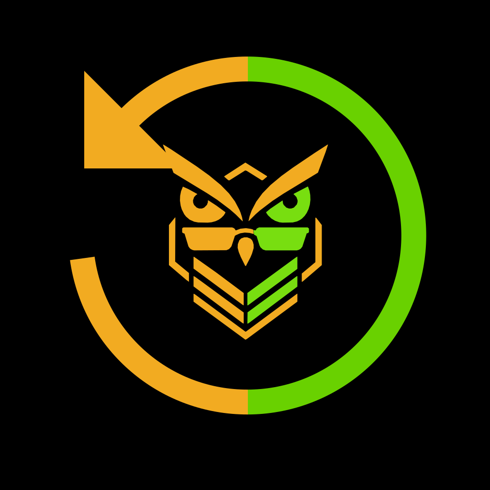
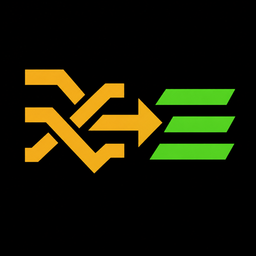
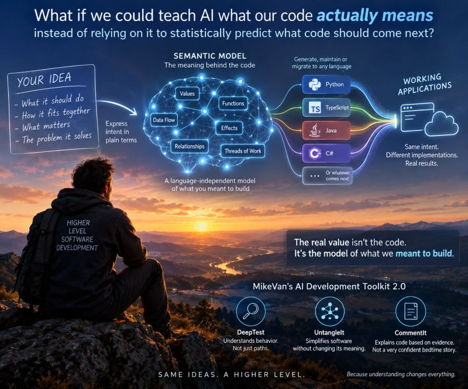
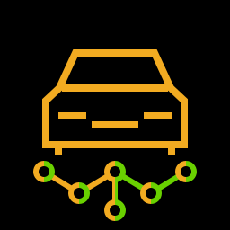
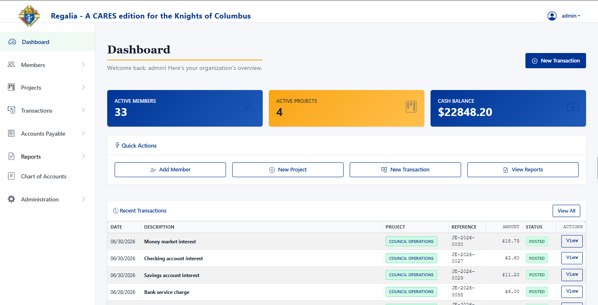

# MikeVan

**Founder, Project Revive Solutions**

**Open source. Fully capable. Built to stay yours.**

## Protect lives. Make understanding possible. Prevent exploitation.

Our work confronts those who profit from violence, ignorance, and division. We build open-source tools that help people recognize danger, understand what is happening, and act for themselves.

[Project Revive Solutions](https://www.projectrevivesolutions.com/) | [Explore my repositories](https://github.com/mikevan?tab=repositories)

**Human life and understanding are worth defending. That is why this company exists.**

## We teach open-source AI what the data means.

**Threat warnings that survive an internet shutdown. Vehicle communications understood as language. Business meaning carried across programming languages.**

Vixen, Vehicle-SLM, and Intellectus connect these outcomes through ontology-based training of existing **open-source AI models**. We teach the relationships behind the data: which events form an attack pattern, how vehicle messages express intent, and how different programming languages express the same business logic.

## Vixen — our flagship

### Democratizing threat intelligence to those who need it most.

A refugee should not need a security operations center or a fortune to understand the danger around them. Vixen provides early warning of targeting in plain language, with technical evidence for post-incident review.

**Vixen’s open-source small language model (SLM) runs directly on the cellphone. Its local analysis continues when a regime shuts down internet access in a targeted area.**

Ontology-based **Low-Rank Adaptation (LoRA)** training connects Wi-Fi and Bluetooth packets to known attack vectors and events across timelines. Vixen deconstructs deauthentication events and connects the evidence to an understandable warning:

> Your network is under attack, increase your threat posture NOW.

Open source. Inspectable code. A warning should not be a luxury.

**Use AI to protect civilians from AI-enabled terror.** UN investigators documented deliberate Russian drone attacks against civilians in Ukraine. Separate reporting describes an AI-guided Russian drone killing three civilians in Zaporizhzhia. Vixen addresses the defensive side of this threat: use an **open-source AI model** to make complex evidence understandable and communicate a direct threat assessment.

In the illustrated scenario, connectivity is lost and a supported drone sensor reports activity. Vixen correlates events across time, context, and known attack patterns, then communicates an assessment:

> **HIGH THREAT.** Connectivity disruption and drone activity indicate a possible coordinated threat. Increase your threat posture NOW.

The **open-source small language model (SLM)** runs on the cellphone. Local analysis continues without internet access. Ontology-based **Low-Rank Adaptation (LoRA)** training teaches the relationships behind the evidence, while technical detail remains available for post-incident review.

The graphic is an illustrative assessment, not a claim of deployment in Ukraine or a verified sequence of an internet shutdown followed by an AI-drone attack. Detecting a drone signal does not establish whether it carries AI.

[Read about Vixen](https://www.projectrevivesolutions.com/vixen) | [UN findings](https://ukraine.un.org/en/304119-russian-authorities-committed-crimes-against-humanity-targeting-civilian-population-through) | [AI-guided drone strike reporting](https://www.tomshardware.com/tech-industry/drones/nvidia-jetson-orin-guided-the-russian-ai-drone-that-killed-three-civilians-in-ukraine-forensic-teams-say)

## Notella

### Teach the meaning. Track the change. Warn in time.

**Notella is PRS’s proprietary tool for training a language model to track the time-based morphology of our semantic model, as expressed through the Vixen ontology.**

The ontology represents what the situation means: the camp, its communications, observed drone signatures, and the relationships between them. Notella’s ontology-guided semantic LoRA training teaches the model to interpret how those relationships and attributes change over time—not simply recognize isolated events.

In the camp-protection scenario, Wi-Fi and BLE flooding coincide with multiple drone signatures growing stronger. The changing pattern drives the assessment from monitoring to an urgent **EVACUATE** warning.

**Vixen is our flagship protective technology. Notella is the specialized training tool behind this approach to understanding change.**

[Explore Notella](https://github.com/mikevan/Notella) | [Watch the animation](https://mikevan.github.io/Notella/infographics/watch.html) | [Read the training tutorials](https://github.com/mikevan/Notella/blob/main/docs/index.md)

## LayerTime

### Because your wrist can do more than count steps.

How would you know if someone were using wireless technology to watch your room? How would you reach anyone if normal communications failed?

LayerTime brings passive Wi-Fi and Bluetooth awareness, GPS positioning, and off-grid mesh communications to the LILYGO T-Watch Ultra. Its wider ecosystem connects wearable interfaces with external radio sensors.

- Recognize selected signatures associated with trackers, surveillance equipment, and network disruption.
- Get position and grid references without a cloud connection.
- Choose MeshCore or Meshtastic communications beyond cellular coverage.

[Explore LayerTime](https://github.com/mikevan/LayerTime) | [Explore the sensors](https://github.com/mikevan/LayerTime-Sensors)

## MikeVan’s AI Development Toolkit - Polyglot

### Built because AI screwed up my code.

I created the toolkit to keep AI from screwing up my code. When it did, I wrote a tool to fix it. Then I thought, “I’m sure I’m not the only one having these issues.” So I released the tools as **free, open-source VS Code extensions**.

| Tool | What it does for you |
| --- | --- |
|  **[Keep-Safe](https://github.com/mikevan/keepsafe)** | **Your project’s CTRL-Z.** Checkpoint before the prompt. Restore when the AI goes sideways. |
|  **[DeepTest](https://github.com/mikevan/deeptest)** | **Find the capabilities your AI quietly removed.** Expose untested code and check whether whole branches of functionality disappeared. |
|  **[UntangleIt](https://github.com/mikevan/untangleit)** | **Make sprawling code manageable.** Break that 100,000-line main.py into smaller, cohesive pieces that are easier to understand and work with. |

**Polyglot** carries the toolkit across languages, with Python, TypeScript, and JavaScript support and adapters for React, Vue, Svelte, and Angular. The tools give you evidence and a way back. You make the decisions.

[Explore the toolkit](https://github.com/mikevan/MADTPackage)

## MikeVan's AI Development Toolkit 2.0 - Intellectus

### What if we could teach AI what our code actually means?

Intellectus puts a **language-independent semantic model** at the center of software development: what the software should do, how its parts fit together, what matters, and the problem it solves.

The model captures **values, functions, data flow, effects, relationships, and threads of work**. Ontology-based training of existing **open-source AI models** connects the code to those meanings, creating a foundation beyond predicting what code comes next.

Generate, maintain, and migrate software around the same intent, with the programming language as an implementation detail. This is the direction of **MikeVan’s AI Development Toolkit 2.0**:

- **DeepTest:** Understand behavior, not just paths.
- **UntangleIt:** Simplify software without changing its meaning.
- **CommentIt:** Explain code based on evidence.

**Working with Python and TypeScript today.** Additional languages and the broader generation and migration workflow are in development.

**The real value is not the code. It is the model of what we meant to build.**

## Vehicle-SLM

### Understand the vehicle through the language it speaks.

Connect what you want a vehicle to do with the messages its systems understand. Vehicle-SLM uses an **open-source small language model (SLM)** to generate candidate CAN frames from vehicle context, observed traffic, and operator intent.

An ontology connects shared meaning to manufacturer families, signal grammar, and operating context. Related vehicles share dialects. OBD-II supplies a Rosetta Stone between standardized meanings and proprietary messages.

The pipeline turns existing DBC signal definitions into structured training examples for the **open-source AI model**. The research corpus spans **86 parsed DBC files across 14 manufacturer families**, producing **3,408 structured training pairs**.

[Explore Vehicle-SLM](https://github.com/mikevan/vehicle-slm)

## CARES

### Your volunteers came to serve. Let them get back to it.

**CARES 1.0 is released.** The Community Accounting & Resource Engagement System connects membership, projects, volunteer assignments, accounting, and reporting so volunteer-led organizations can get back to their mission.

Volunteers record familiar activities such as dues, donations, and expenses. CARES creates the journal entries underneath. Accountants retain a full debit-and-credit interface for the work that needs it.

REGALIA is the Knights of Columbus edition of the same core. CARES began as my way of giving back to an organization whose members helped me as a child.

[Explore CARES](https://github.com/mikevan/cares) | [Explore the CARES product materials](https://github.com/mikevan/cares-site)

## Delos

### Remove language as a barrier to understanding.

Read an application in a language you understand, without searching for a translation button. Delos automatically adapts pages to your browser’s language preference.

In the early 1990s, I worked as a professional translator with German, Arabic, and English. I saw incorrect interpretations become sources of conflict. **The purpose of Delos is to remove language as a barrier to understanding.**

The Flask implementation adds automatic translation without rewriting templates, with 20 target languages, local inference using an **open-source AI model** through Ollama or a compatible hosted endpoint, and content-aware caching.

[Explore Delos](https://github.com/mikevan/delos-flask)

## The ambition has a history.

**Insight was my first truly innovative product.** In the late 1990s, I built an online commerce platform for Realtor associations that combined credit-card authorization while customers waited, PGP-based transaction encryption, and integration with an existing proprietary database.

Another early project brought meal planning to a shopping kiosk. Choose a main, two sides, a dessert, and the number of people coming to dinner. The software calculated ingredient quantities, arranged a shopping list in store order, and supplied a coupon to buy everything.

That pursuit continues through my work today: **make the impossible undeniable.**

## Open source. Fully capable. Built to stay yours.

Project Revive Solutions exists to protect open-source intellectual property and keep these products available to the people who use and build them.

These are complete tools, not stripped-down editions designed to push you toward a paid product. We release the source so you can inspect, use, modify, and contribute under each project’s open-source license.

The company’s purpose is to defend that work against patent abuse, infringement, and attempts to turn shared innovation into proprietary control. All the AI models we use are open source.

**The company exists to defend the work and its independence. The products exist to serve you.**

[Explore the repositories](https://github.com/mikevan?tab=repositories) | [Project Revive Solutions](https://www.projectrevivesolutions.com/)

> “Any sufficiently advanced technology is indistinguishable from magic.”
>
> Arthur C. Clarke

## The kind of innovation I’m after

Nobody has tried to burn me at the stake as a witch or called an exorcist because my technology was sooo scary magical. At least, not yet. But I have seen ideas I built into products more than thirty years ago start showing up in the market today. That is its own kind of validation.

That is the level of innovation I’m after: technology so far beyond what people expect that using it forces them to reconsider what is possible. A clever demonstration is not enough. The capability has to be real, the code open to inspection, and the result undeniable.

